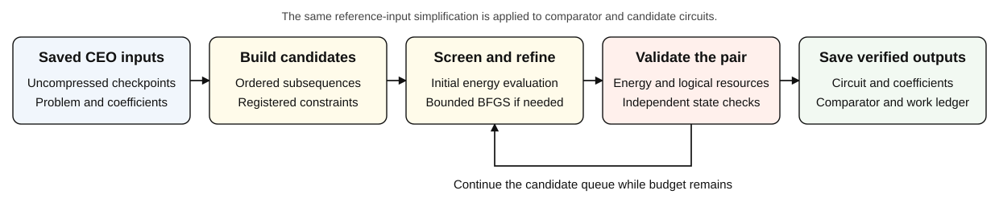
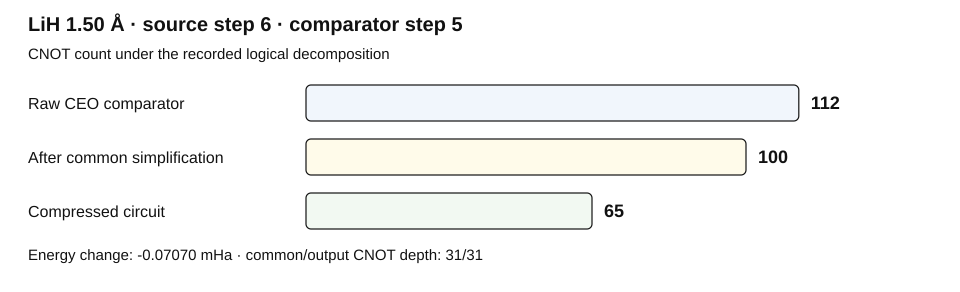

# CEO Circuit Compression

[](https://github.com/Reimangod/ceo-circuit-compression/actions/workflows/verify.yml)

**Smaller circuits from saved CEO-ADAPT-VQE checkpoints, with verifiable energy,
resource, and search-cost records.**

This repository contains a bounded, source-only compression policy and the data
needed to inspect its recorded results. The policy constructs smaller circuits,
refines their coefficients when needed, and independently checks each reported
comparison. It uses uncompressed CEO checkpoints rather than learned models or
previously successful compression recipes.

**Access:** private · **Data release:** [artifact-v1.0.0](https://github.com/Reimangod/ceo-circuit-compression/releases/tag/artifact-v1.0.0)
· **Python:** 3.11–3.12 · **Code:** [Apache-2.0](LICENSE) · **Data:** [CC BY 4.0](LICENSE-DATA)

## Start here

| Your goal | Guide |
| --- | --- |
| Understand the method and comparison | [Study overview](docs/OVERVIEW.md) · [Policy specification](docs/PROTOCOL.md) |
| Inspect the recorded numerical results | [Current-policy results](docs/RESULTS.md) · [Data dictionary](docs/DATA_DICTIONARY.md) |
| Download, verify, and reconstruct the data | [Quick start](docs/QUICKSTART.md) · [Reproducibility](docs/REPRODUCIBILITY.md) |
| Inspect the tests or contribute a change | [CI coverage](docs/CI.md) · [Contributing](CONTRIBUTING.md) |

## How compression works



Candidate structures come from ordered block subsequences and registered
multi-parameter-to-one-parameter constraints. The same reference-input
simplification is applied to the CEO comparator and the candidate. Energy
screening and short BFGS allocations share a fixed, circuit-size-dependent budget.
A candidate that already meets the energy condition can be saved without
coefficient reoptimization.

For a verified compression pair, the recorded acceptance conditions are:

```text
E_compressed <= E_saved_CEO + 1e-9 Ha
CNOT_compressed < CNOT_common_simplified_CEO
CNOT_depth_compressed <= CNOT_depth_common_simplified_CEO
```

The saved comparator can be earlier than the checkpoint used to construct the
candidate. Every result therefore records both starting and comparison steps.
All four resource values in a row belong to the same pair of actual circuits.

## What the archive contains

| Collection | Molecular conditions | Starting circuits | Meaning |
| --- | ---: | ---: | --- |
| Current policy | **22** across LiH, HF, BeH₂, and N₂ | **66** | One registered policy and a common budget rule |
| Historical full-orbital archive | **41** across seven molecules | Multiple recorded studies | Includes the 22 current conditions; methods and budgets differ |

Here, a condition is a molecule, geometry, basis, and full-orbital physical
problem. The historical collection also includes H₄, H₆, and H₈. It is a
provenance archive, not an expansion of the current-policy benchmark.

### One recorded comparison



This pair has a compressed-minus-comparator energy difference of
**−0.07070 mHa**. The total CNOT reduction is **42.0%** relative to the raw
decomposition; the additional reduction is **35.0%** relative to the
common-simplified comparator. The compressed CNOT depth equals the
common-simplified depth of 31. This is one recorded pair, not a guarantee for
every starting circuit. [View all 22 current comparisons](docs/RESULTS.md).

## Quick verification

With Python 3.11 or 3.12 and an authenticated
[GitHub CLI](https://cli.github.com/):

```bash
gh repo clone Reimangod/ceo-circuit-compression
cd ceo-circuit-compression
python3 tools/check_repository.py
python3 tools/fetch_data.py
python3 tools/verify.py
python3 tools/reconstruct_census.py
python3 tools/reproduce.py --tables-only
```

The first check needs only the checkout. The following commands retrieve the
checksum-verified release data, reconcile recorded costs and comparisons, and
export tables. **They run no molecular search, coefficient optimization, or FCI.**
Allow about 1.8 GiB for the expanded data, plus temporary download space.
See the [quick start](docs/QUICKSTART.md) for offline assets, locked environments,
tests, figure reconstruction, and expected outputs.

## Scope of the evidence

- Resource counts are **logical**, under the recorded decomposition convention.
  Raw decomposition, common simplification, and additional search are separated.
- `W = N_energy + 2 * N_scalar_gradient_components` is an **evaluation-cost
  model**, not physical shots or the CEO paper's grouped Measurement Cost.
- The archive checks energy non-worsening against its identified comparator.
  Source convergence, final stationarity, and absolute ground-state accuracy
  remain separate attributes.
- These records establish saved circuit comparisons. Matched-work superiority
  over continued CEO growth, hardware advantage, and transfer to unseen molecules
  require separate evidence.

The [study overview](docs/OVERVIEW.md) explains missing records, historical
certification limits, and the supported molecular conditions.

## Run a new compression task

New execution is a separate, explicit operation. The current launcher is
qualified for **macOS `sandbox-exec`**; Linux CI checks synthetic numerical
fixtures and archive reconstruction, not a production Linux compression run.

```bash
uv sync --frozen --extra policy
uv run --frozen python tools/run_policy.py \
  --task-id lih-1.20A-all-orbitals-root006 \
  --output execution/new-attempt
```

Read the [execution guide](docs/REPRODUCIBILITY.md#explicit-policy-execution)
first. The launcher preserves the registered policy and budget, isolates the
worker from historical compression results and the network, and requires a new
output directory. Verification and CI never launch this command.

## Repository map

```text
policy/frozen/       Unchanged compressor and exact-sector kernel
third_party/         Pinned upstream CEO implementation and notices
data/metadata/       Identities, checksums, selections, and cost definitions
data/tables/         Lightweight recorded tables
data/raw/            Release data objects; downloaded separately, never in Git
tools/               Verification, reconstruction, and explicit execution tools
docs/                English guides and repository overview figures
report/              Preserved source-language report and figure artifacts
tests/               Archive, numerical-fixture, and repository-quality tests
```

The maintained guides and overview figures are in English. Historical field
labels, the original Japanese Word report, its figures, and frozen source files
retain their original content for traceability.

## Citation and licensing

Use [CITATION.cff](CITATION.cff) to cite the code and data version. The current
private release has no DOI. Original code is covered by [Apache-2.0](LICENSE);
original data and documentation use [CC BY 4.0](LICENSE-DATA). Third-party terms
and attribution are retained in [NOTICE](NOTICE).

The CEO method is described in the published paper:

Ramôa, M. et al. *Reducing the resources required by ADAPT-VQE using coupled
exchange operators and improved subroutines*. **npj Quantum Information 11**,
86 (2025). [DOI: 10.1038/s41534-025-01039-4](https://doi.org/10.1038/s41534-025-01039-4).

The [upstream implementation](https://github.com/mafaldaramoa/ceo-adapt-vqe) is
pinned to `a3f89d03e6a03c89767d3cf8ee7657a57653dda0`.
