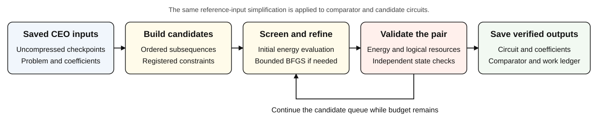

# Study overview

## Research task

The study asks whether a saved CEO-ADAPT-VQE trajectory contains smaller circuits
that can match or improve the energy of one of its saved checkpoints. Compression
operates after CEO growth. It searches ordered subsequences and registered
coefficient constraints, rather than repeating operator-pool selection.

The input is the physical problem, reference state, gate definitions, and
uncompressed checkpoints through a chosen starting step. The output is an
identified circuit/comparator pair with coefficients, logical resources,
independent verification, and an evaluation-cost ledger.

## Two collections with different roles

| Molecule | Current-policy conditions | Historical full-orbital conditions | Historical basis |
| --- | ---: | ---: | --- |
| LiH | 8 | 12 | STO-3G |
| HF | 2 | 2 | STO-3G |
| BeH₂ | 8 | 12 | STO-3G |
| N₂ | 4 | 4 | STO-3G |
| H₄ | — | 2 | STO-3G |
| H₆ | — | 7 | STO-3G |
| H₈ | — | 2 | 6-31G |
| Total | **22** | **41** | |

The 41 historical conditions include the 22 current-policy conditions. Historical
methods, budgets, starting points, and verification coverage differ. H₈ uses
32 qubits and belongs to a separate earlier experiment; the current compressor
supports at most 20 physical wires.

Full-orbital means that all spatial orbitals from the selected basis are retained,
with no frozen-core exclusion. It does not mean a complete basis-set limit.
Exact coordinates, electron counts, qubit counts, and basis labels are in
[conditions.csv](../data/tables/conditions.csv).

## Starting checkpoint and comparison checkpoint

Each current condition has three registered starting circuits, giving 66 tasks.
For a trajectory ending at step `R`, starts are selected at `ceil(R/3)`,
`ceil(2R/3)`, and `R`, with duplicate-step handling defined by the protocol.

The starting checkpoint provides blocks and inherited coefficients. A comparison
checkpoint provides the energy and resources against which a candidate is judged.
Those checkpoints can differ. For example, the LiH 1.50 Å result starts at step 6
and is compared with step 5. Its energy improves on step 5, while its energy
relative to the later starting point is a separate comparison.

The [current results](RESULTS.md) select one saved eligible pair per condition
using the recorded total-CNOT-reduction rule. They are descriptive maxima from
those runs, not prospective success guarantees for every input.

## Three resource levels

1. **Raw CEO decomposition:** the originally registered elementary gate sequence.
2. **Common-simplified comparator:** the same CEO checkpoint after the
   reference-input simplification also applied to candidates.
3. **Compressed circuit:** the verified candidate after simplification and search.

Total reduction compares level 1 with level 3. Additional search reduction compares
level 2 with level 3. The percentages have different denominators and must be
reported separately. All metrics in one row come from the same circuit pair.

## Costs and outcomes

The cost model is `W = N_energy + 2 * N_scalar_gradient_components`.
Recorded current-policy search cost is 117,745 W. Qualification cost of 77 W
and post-search validation cost of 24 W are separate entries in
[cost-breakdown.json](../data/metadata/cost-breakdown.json).
Original CEO generation cost is separate and is not fully known for every source.

W is neither physical shots nor grouped Measurement Cost from the CEO paper.
It models evaluation effort. No hardware measurements were collected in these
archived runs. `MODEL_CAP_TERMINAL` records exhaustion of the permitted model
budget; it does not assert optimizer convergence.

Source convergence, final stationarity, comparator energy non-worsening, and
absolute ground-state accuracy are different attributes. Interrupted, rejected,
missing, and verified-no-improvement records retain their original meanings.
Some historical comparator certificates are not joined to this archive, and those
records retain their restricted evidence scope.

## Evidence boundary

This archive supports inspection of its saved circuit pairs and their costs.
It does not establish, by itself, superiority over continuing CEO growth at the
same work budget, lower physical shot cost, hardware noise advantage, or
generalization to unseen molecules.

All maintained guides and overview graphics are in English. Original report
artifacts, historical labels, and frozen implementation files retain their
source language and bytes. That preserves their identity rather than retroactively
rewriting the research record.

See the [policy specification](PROTOCOL.md), [data dictionary](DATA_DICTIONARY.md),
and [archive design](ARCHIVE_DESIGN.md) for the detailed contracts.
