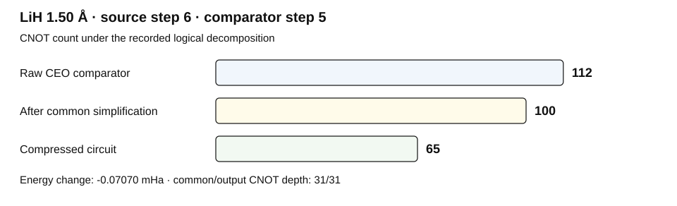

# Current-policy results

These are the 22 condition-wise largest total CNOT reductions selected from
the saved current-policy runs. They are descriptive recorded comparisons,
not guarantees for every start or evidence of matched-work superiority.

All conditions use the full-orbital STO-3G problem. The four resource changes
in one row belong to the same actual circuit pair. `Start / compare` identifies
the construction source and the saved CEO comparison step, respectively.

Resource arrows run from the raw CEO decomposition to the compressed circuit.
Total reduction therefore includes the common reference-input simplification.
Energy change is `E_compressed - E_comparator`, in mHa. Tiny positive values
are retained and fall within the registered 1e-9 Ha tolerance.

| Molecule | Bond length / Å | Start / compare | Energy change / mHa | CNOT count | CNOT depth | Parameters | Total depth | Total CNOT reduction |
| --- | ---: | ---: | ---: | ---: | ---: | ---: | ---: | ---: |
| LiH | 1.20 | 12 / 11 | +1.29177e-08 | 252 → 231 | 96 → 92 | 37 → 36 | 423 → 392 | 8.3% |
| LiH | 1.50 | 6 / 5 | -0.0707039 | 112 → 65 | 35 → 31 | 14 → 11 | 170 → 110 | 42.0% |
| LiH | 1.80 | 5 / 4 | +5.35163e-08 | 90 → 69 | 28 → 24 | 10 → 9 | 130 → 99 | 23.3% |
| LiH | 2.00 | 6 / 5 | -0.283807 | 112 → 56 | 35 → 28 | 14 → 10 | 170 → 97 | 50.0% |
| LiH | 2.20 | 5 / 2 | -1.59872e-11 | 45 → 24 | 14 → 10 | 5 → 4 | 65 → 34 | 46.7% |
| LiH | 2.80 | 5 / 2 | +2.39748e-07 | 45 → 24 | 14 → 10 | 5 → 4 | 65 → 34 | 46.7% |
| LiH | 3.00 | 9 / 2 | +2.80936e-07 | 45 → 24 | 14 → 10 | 5 → 4 | 65 → 34 | 46.7% |
| LiH | 3.20 | 11 / 2 | -18.2033 | 45 → 7 | 14 → 5 | 5 → 3 | 65 → 18 | 84.4% |
| HF | 0.90 | 6 / 5 | -0.0843733 | 85 → 50 | 41 → 26 | 10 → 7 | 128 → 76 | 41.2% |
| HF | 1.50 | 6 / 2 | -0.0501739 | 27 → 7 | 14 → 5 | 3 → 3 | 39 → 18 | 74.1% |
| BeH₂ | 1.20 | 8 / 1 | -1.79618 | 27 → 6 | 7 → 3 | 3 → 2 | 39 → 8 | 77.8% |
| BeH₂ | 1.30 | 4 / 1 | -0.564057 | 27 → 6 | 7 → 3 | 3 → 2 | 39 → 8 | 77.8% |
| BeH₂ | 1.40 | 4 / 1 | -0.942134 | 27 → 6 | 7 → 3 | 3 → 2 | 39 → 8 | 77.8% |
| BeH₂ | 1.60 | 3 / 1 | -1.28318 | 27 → 6 | 7 → 3 | 3 → 2 | 39 → 8 | 77.8% |
| BeH₂ | 2.00 | 12 / 11 | +1.84812e-07 | 288 → 266 | 95 → 91 | 40 → 39 | 472 → 434 | 7.6% |
| BeH₂ | 2.20 | 12 / 11 | +3.51186e-09 | 310 → 288 | 110 → 100 | 41 → 40 | 503 → 465 | 7.1% |
| BeH₂ | 2.80 | 4 / 3 | -1.89708 | 81 → 28 | 21 → 12 | 9 → 6 | 117 → 48 | 65.4% |
| BeH₂ | 3.00 | 17 / 17 | +8.27868e-07 | 513 → 468 | 185 → 181 | 69 → 66 | 841 → 775 | 8.8% |
| N₂ | 0.90 | 16 / 13 | +6.91642e-08 | 637 → 601 | 156 → 152 | 105 → 103 | 1150 → 1097 | 5.7% |
| N₂ | 1.10 | 11 / 6 | +4.50896e-07 | 276 → 240 | 70 → 66 | 43 → 41 | 486 → 433 | 13.0% |
| N₂ | 1.30 | 6 / 4 | +1.62004e-09 | 168 → 146 | 40 → 36 | 22 → 21 | 274 → 236 | 13.1% |
| N₂ | 1.60 | 13 / 8 | +6.26983e-08 | 373 → 346 | 90 → 86 | 54 → 53 | 644 → 604 | 7.2% |

## Reading the comparison

The CNOT-depth guard is applied against the common-simplified comparator,
not only the raw decomposition shown in the table. The starting circuit
can have a lower energy than the selected earlier comparison checkpoint.

For this LiH 1.50 Å pair, the raw CEO comparator has 112 CNOTs, the
common-simplified comparator has 100, and the output has 65. Total and
additional-search CNOT reductions are 42.0% and 35.0%, respectively.

## Source and reconstruction

This page and its example SVG are generated by
`python3 tools/build_readme_assets.py` from the unchanged
[recorded selection](../data/metadata/report-selection.json). Candidate IDs,
full-precision values, common-simplified resources, and evidence paths remain
in that metadata. The repository checks detect stale generated views.

[Method](PROTOCOL.md) · [Data dictionary](DATA_DICTIONARY.md) ·
[Reconstruct and verify the raw records](QUICKSTART.md)
